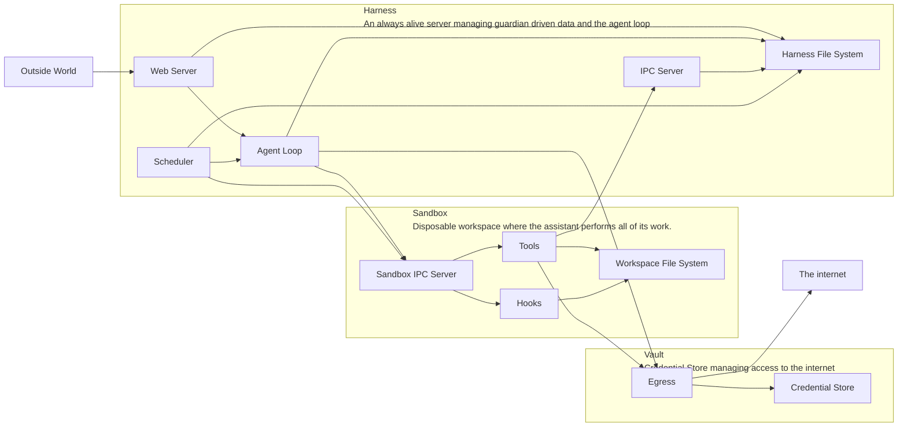

This page outlines the Cadet north star we're building towards. All external contribution will be evaluated against this doc.

<!-- TODO: Add colors to the edges for RW, RO, RM -->
<!-- TODO: Make Tools a subgraph that also includes definitions, skills, and MCPs -->

## The Harness

The Harness becomes the merged gateway + assistant. It controls agent loop, the clock that fires schedules, and is the admission point for all incoming requests to the assistant. It continues to manage all guardian write only data in its own Harness File System.

The Harness File system will include data surrounding:
- Contacts - who the assistant is allowed to interact with.
- Trust rules - what actions the assistant is allowed to take.
- Agent Loop Configuration - which model profiles the assistant acts as in any given moment.

## The Sandbox

A disposable execution plane that keeps the parts the assistant physically needs to perform work. It holds zero authority: no keys, no clock, no authority over the loop. It cannot write back to the Harness' File System, but can read its data via the read-only Harness IPC Server.

## The Vault

A credential store that ensures that the Agent Loop can never read the value of credentials, enforcing all use through an Egress proxy.
